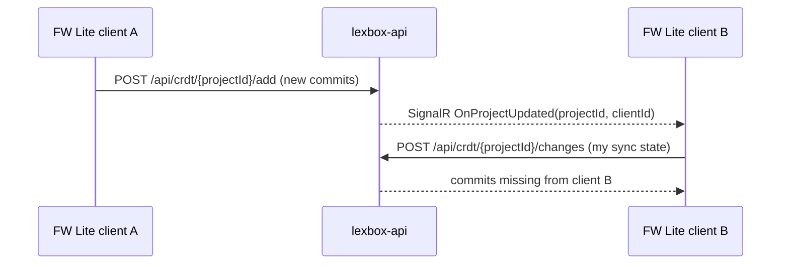
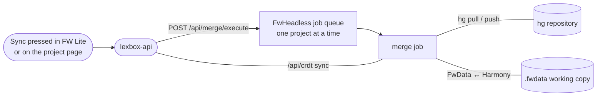

What Lexbox and FieldWorks Lite talk to, and over which protocol. Start here if you maintain another tool and want to connect it.

## FieldWorks Classic via Chorus (Mercurial)

FieldWorks Classic (FLEx) sends and receives through Chorus, which is a Mercurial client. Lexbox's .NET API proxies those requests to two containers sharing the repository volume: `hgweb` (standard hg wire protocol) and `hgresumable` (chunked, resumable transfer for bad connections).

| Route on lexbox-api | Purpose |
| --- | --- |
| `/{project-code}` or `/hg/{project-code}` | hg Send/Receive. The bare `/{project-code}` form is the URL baked into Chorus clients around the world, so it has the lowest route precedence. |
| `/api/v03` | hg-resumable Send/Receive |

Production hostnames all route to `lexbox`: `hg-public.languagedepot.org`, `hg-private.languagedepot.org`, `resumable.languagedepot.org` (and the matching `*.languageforge.org` names). Staging uses `hg-staging.languageforge.org` / `resumable-staging.languagedepot.org`; develop uses `hg.lexbox.dev.languagetechnology.org` / `resumable.lexbox.dev.languagetechnology.org`.

## Legacy Language Depot API

Older clients still call the Language Depot API, so it stays:

| Route | Used by |
| --- | --- |
| `POST /api/user/{userName}/projects` | Chorus/FLEx and Language Forge, to list a user's projects. Anonymous route; the password goes in the body and is checked against the stored hash. Returns identifier, name, repository URL and role per project. |

## Harmony sync between FieldWorks Lite and Lexbox

FW Lite keeps the whole project locally in SQLite with [Harmony](https://github.com/sillsdev/harmony), SIL's CRDT library: every edit is a commit, and merging is order-independent, so there are no conflicts to resolve. Sync is plain HTTPS; SignalR only says "something changed, come and get it".

| Endpoint | Purpose |
| --- | --- |
| `GET /api/crdt/{projectId}/get` | server's sync state (head commits) |
| `POST /api/crdt/{projectId}/add` | push commits; the server then broadcasts `OnProjectUpdated` |
| `POST /api/crdt/{projectId}/changes` | send your sync state, stream back what you're missing |
| `POST /api/crdt/{projectId}/countChanges` | cheap "how far behind am I" count |
| `GET /api/crdt/listProjects`, `/lookupProjectId` | discovery |

The push hub is at `/api/hub/crdt/project-changes`; a client calls `ListenForProjectChanges(projectId)` to join the project group. All of it requires an auth token with the `LexboxApi` or `SendAndReceive` scope. See [How sync works](/fw-lite/how-sync-works) for the user-facing version.

## FwHeadless: the bridge between Harmony and Mercurial

FwHeadless owns a working copy of the FieldWorks project and reconciles both worlds: it pulls/pushes the `.fwdata` file over Mercurial, and syncs the same content as Harmony commits with lexbox-api.

**It is not a scheduler and it does not watch for changes.** The merge job runs only when a user asks for it: the Sync button in FW Lite or "Sync FieldWorks Lite" on the Lexbox project page. Both go through `POST /api/fw-lite/sync/trigger/{projectId}` on lexbox-api, which calls FwHeadless's `POST /api/merge/execute`, which queues the job. The queue is in-process and serialized, so one project syncs at a time and a project already queued is not queued twice. Callers poll FwHeadless for the job's status. Media files ride along with the same job over `/api/media/*`.

## Platform.Bible extension

[`platform.bible-extension/`](https://github.com/sillsdev/languageforge-lexbox/tree/develop/platform.bible-extension) is a Platform.Bible (paranext) extension named `lexicon`. On activation it launches a FW Lite process on `http://localhost:29348` and talks to it over HTTP REST, then exposes `lexicon.entryService` as a PAPI network object so other extensions can add, find and display dictionary entries. UI is React WebViews registered with the platform.

## APIs Lexbox offers

| API | Where | Notes |
| --- | --- | --- |
| GraphQL | `/api/graphql` | Hot Chocolate; this is what the SvelteKit UI uses. Explorer (Nitro, formerly Banana Cake Pop) at `/api/graphql/ui`. |
| REST | `/api/**` | Includes `/api/crdt/*`, `/api/fw-lite/sync/*` and TUS project upload at `/api/project/upload-zip/{project-code}`. Scalar API reference at `/api/scalar` (`/api/swagger` redirects there). |
| Health | `/api/healthz` | |
| Security contact | `/.well-known/security.txt` | [security.txt standard](https://securitytxt.org/) |

## Localization: Crowdin

Source strings live in gettext catalogs; Crowdin holds the translations, but only for FW Lite's `en.po` and the Platform.Bible extension description (`crowdin.yml`). The Lexbox web app's JSON strings are not on Crowdin. Inbound, Crowdin opens a PR from `l10n_develop` on each sync. Updated source strings reach Crowdin by a separate upload, not from GitHub. All seven target locales are machine-translation covered, which is why brand names (`Lexbox`, `FieldWorks`, `SIL`) need glossary "Trademark" entries, because MT otherwise translates them literally.

## Observability: OpenTelemetry and Honeycomb

The server-side services (lexbox-api, the UI, hgweb and FwHeadless) export OTEL traces to an otel-collector sidecar in the lexbox pod (gRPC 4317, HTTP 4318), which forwards to Honeycomb. The "Error code" shown at the bottom of an error message in the app is the trace ID, so support can find what went wrong.

FieldWorks Lite exports no traces. It reports usage and errors to Mixpanel.
