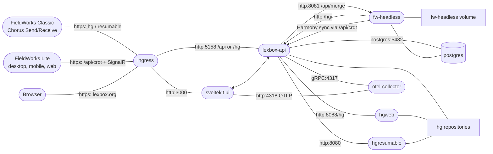

Three things live in this repo. Lexbox and FwHeadless run server-side and share one database; FwHeadless keeps its own volume and reaches Mercurial over HTTP through lexbox-api's `/hg/` route; FieldWorks Lite is a client app with its own local copy of each project.

| Part | What it is |
| --- | --- |
| **Lexbox** (formerly Language Depot) | The web app and project host: user/org/project management, permissions, and the server side of both sync protocols. SvelteKit UI in front of a .NET API. |
| **FieldWorks Lite** (FW Lite) | A lightweight dictionary editor for Windows, Linux, macOS and Android. There is no hosted web version (the Linux build is a local server you open in your browser). Keeps a local SQLite copy of the project and syncs it to Lexbox as Harmony commits. |
| **FwHeadless** | The server-side bridge between the Harmony world (FW Lite) and the Mercurial world (FieldWorks Classic (FLEx)). It runs the merge job that reconciles the two. |

FieldWorks Classic is not in this repo, but it's a first-class client: it talks to Lexbox with Chorus Send/Receive over Mercurial.

## Deployed system

Everything above runs in Kubernetes; the same manifests serve production, staging, develop and local development (see [deployment](https://github.com/sillsdev/languageforge-lexbox/blob/develop/deployment/README.md)). Telemetry is OpenTelemetry, exported to Honeycomb.

## Tech stack

- **Backend**: .NET 10, C#, Entity Framework Core, GraphQL (Hot Chocolate)
- **Frontend**: SvelteKit, TypeScript
- **FW Lite client**: .NET MAUI (desktop/mobile) or an ASP.NET Core host (web), both driving the same Svelte viewer
- **Sync engine**: [Harmony](https://github.com/sillsdev/harmony), SIL's CRDT library, stored in SQLite on the client
- **Database**: PostgreSQL
- **Version control for FieldWorks projects**: Mercurial (hgweb + hgresumable), driven by Chorus
- **Infrastructure**: Docker, Kubernetes, Skaffold, Tilt

## Next

- [Integrations](./integrations.md): how FW Lite and Lexbox talk to FieldWorks, Platform.Bible and everything else.
