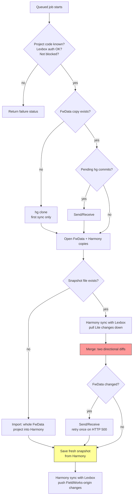

FwHeadless is the only place where Harmony data and FwData meet. It keeps a per-project Harmony database *and* a
Mercurial working copy of the FieldWorks project, and merges between them on request.

:::warning[Data-loss territory]
This is the highest-risk code in the repo. A bug here can overwrite FieldWorks edits, corrupt the hg repo, or
produce divergent data that can't be reconciled.
:::

## The merge is user-triggered, always

There is no scheduler, no cron and no Mercurial hook. A merge happens because someone pressed a button:

- FieldWorks Lite → the Sync dialog's **Sync** button, or
- Lexbox → **Sync FieldWorks Lite** on the project page.

Both go `POST /api/fw-lite/sync/trigger/{projectId}` (Lexbox) → `POST /api/merge/execute` (FwHeadless), which
only *queues* the job. [One global worker](https://github.com/sillsdev/languageforge-lexbox/blob/develop/backend/FwHeadless/Services/SyncHostedService.cs) processes projects one
at a time, so a queued project waits. Queuing is deduplicated: triggering a project that's already queued or running
is a no-op.

The client then polls for the result, but the job doesn't depend on it: closing FieldWorks Lite or the web page
doesn't stop a queued job. FieldWorks Lite stops waiting after **15 minutes**; the Lexbox web button keeps waiting. The **first-ever**
sync for a project clones the hg repo and imports every entry into a new Harmony database, which takes minutes.

## The sync cycle

**The snapshot** is a JSON file kept next to the project's data. It records the whole
dictionary state: entries, senses, parts of speech and the rest, as of the last successful merge. Two things
depend on it:

- It's the baseline the merge diffs against (see [Merge semantics](#merge-semantics) below). Without a "what it
  was last time", there's no way to tell what each side changed.
- Its presence decides between merging and importing. No snapshot (normally a project's first sync, but also a
  lost snapshot) means FwHeadless *imports* the whole FwData project into the Harmony database instead of
  merging, and skips pulling FieldWorks Lite changes from Lexbox first.

It's rewritten only **after** the post-merge Send/Receive succeeds, and from the Harmony data, not from FwData.
The [sync worker](https://github.com/sillsdev/languageforge-lexbox/blob/develop/backend/FwHeadless/Services/SyncHostedService.cs) explains why both details matter.

## Merge semantics

[The merge](https://github.com/sillsdev/languageforge-lexbox/blob/develop/backend/FwLite/FwLiteProjectSync/CrdtFwdataProjectSyncService.cs) computes two directional diffs per entity type against the snapshot:

1. snapshot → current FwData, applied to Harmony
2. current FwData → current Harmony data, applied to FwData

Because step 1 runs first, its result is already in Harmony when step 2 reads it. So:

| Field changed since last merge | Result |
|---|---|
| In FieldWorks only | FieldWorks value wins (arrives in Harmony via step 1) |
| In FieldWorks Lite only | Lite value wins (arrives in FwData via step 2) |
| On both sides | **FieldWorks Classic value wins** |

Entity order matters. Writing systems, publications, parts of speech, semantic domains, complex form types and
morph types are synced before entries, because entries reference them. Complex forms are two-phase for the same
reason. On the hg side, Chorus does the merging between FwHeadless's copy and other users' commits; FwHeadless
never resolves those itself.

## Failure modes

A job ends in success (with counts of the changes made on each side) or a failure that names the step: the
project is unknown, FwHeadless can't authenticate to Lexbox (checked first, so the job fails fast), the project
is blocked, the repo isn't a FieldWorks project, Send/Receive failed, or the Harmony sync failed. A caller
waiting on a job can also time out while the job keeps running.

**Blocking.** If Chorus reports a rollback during Send/Receive, FwHeadless blocks the project from syncing
immediately, before *and* after the merge. A blocked project is refused at the trigger endpoint (HTTP 423) and
checked again when its queued job starts. Unblocking is a deliberate action; there's no button for it.

Other landmines worth knowing: a stale snapshot makes every subsequent diff wrong; a stale hg lock hangs
Send/Receive; and a FieldWorks data-model version that doesn't match FwHeadless's risks corrupt data.
